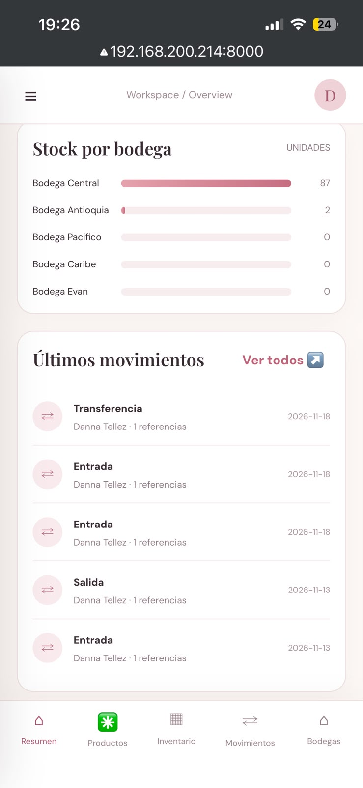
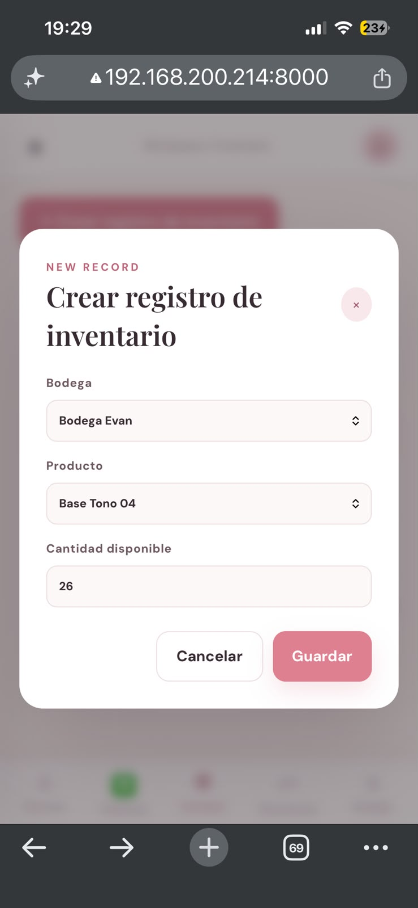
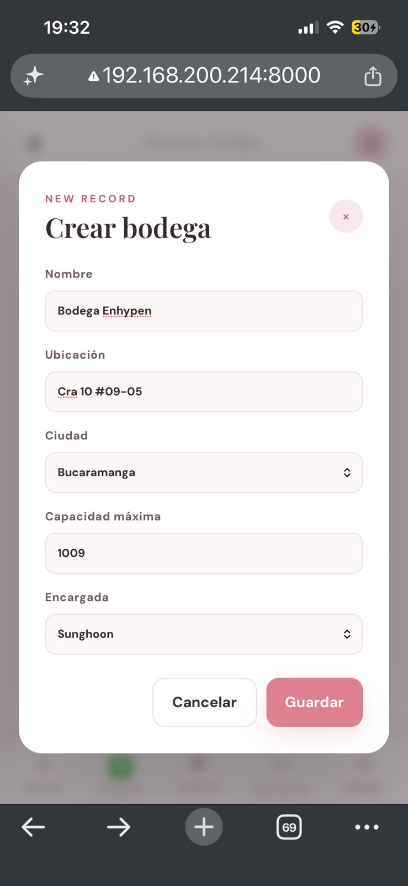
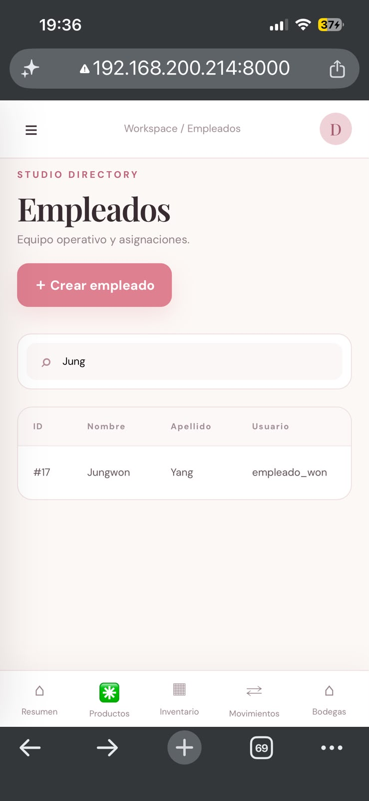

# LogiTrack - Manejo de bodegas

## Descripción del proyecto

**LogiTrack** es un sistema backend desarrollado para LogiTrack S.A., una empresa que administra bodegas ubicadas en diferentes ciudades.

El sistema permite gestionar bodegas, productos e inventarios, registrar movimientos de mercancía y llevar un control de auditoría de las operaciones realizadas por los usuarios.

El proyecto busca centralizar la información, mejorar el control de inventarios, garantizar la trazabilidad de los movimientos y proteger el acceso mediante autenticación y autorización con JWT.

### Objetivo general

Desarrollar un sistema de gestión y auditoría de bodegas que permita registrar transacciones de inventario y generar reportes auditables de los cambios realizados por cada usuario.

## Tecnologías utilizadas

- **Java 21:** lenguaje de programación.
- **Spring Boot 4.1.2:** framework para el desarrollo del backend.
- **Spring Security:** seguridad y control de acceso.
- **JWT:** autenticación mediante tokens.
- **Spring Data JPA / Hibernate:** persistencia y gestión de entidades.
- **MySQL:** sistema gestor de base de datos.
- **Maven:** gestión de dependencias y construcción del proyecto.
- **Swagger / OpenAPI 3:** documentación y pruebas de endpoints.
- **Lombok:** reducción de código repetitivo.

## Funcionalidades principales

- Gestión de bodegas: registro, consulta, actualización y eliminación.
- Gestión de productos: operaciones CRUD.
- Gestión de inventario por bodega.
- Registro de entradas, salidas y transferencias de productos.
- Auditoría de operaciones de tipo INSERT, UPDATE y DELETE.
- Autenticación y autorización mediante JWT.
- Control de acceso según roles ADMIN y EMPLEADO.
- Consulta de productos con stock bajo.
- Filtros de movimientos por fechas.
- Consultas de auditoría por usuario, entidad y tipo de operación.
- Reporte general de inventario y productos más movidos.
- Manejo global de excepciones y validaciones.

## 1. Repositorios del proyecto

- **Frontend:** https://github.com/sunisonfire/LogiTrack-Frontend
- **Backend:** https://github.com/sunisonfire/LogiTrack

El frontend no incluye la base de datos ni el backend. Para utilizar todas sus funciones, Spring Boot y MySQL deben estar configurados y ejecutándose.

## 2. Estructura del proyecto

```text
LogiTrack/
│
├── LogiTrack/src/
│   ├── main/
│          │   ├── java/com/DannaS2/LogiTrack/
│          │   │   ├── config/
│          │   │   ├── controller/
|          │   │   ├── dto/
|          │   │   ├── exception/
│          │   │   ├── mapper/
│          │   │   ├── model/
│          │   │   ├── repository/
│          │   │   ├── security/
│          │   │   ├── service/
│          │   │   └── LogiTrackApplication.java
│          │   │
│          │   └── resources/
│          │       └── application.properties
│          │
│          └── test/
│              └── java/com/DannaS2/LogiTrack/
│
├── MySQL/
│   ├── database.sql
│   └── inserts.sql
│
├── Evidencias/
│   ├── Swagger/
│   ├── Autenticacion/
│   ├── Bodegas/
│   ├── Productos/
│   ├── Inventario/
│   ├── Movimientos/
│   ├── Auditoria/
│   ├── Reportes/
│   └── Pruebas/
│
├── pom.xml
└── README.md
```

- `index.html`: estructura de las vistas de acceso y aplicación.
- `css/styles.css`: estilos y diseño responsive.
- `js/config.js`: dirección base de la API y tiempo máximo de espera.
- `js/app.js`: autenticación, navegación, formularios y consumo de endpoints REST.
- `Evidencias/`: carpeta destinada a las capturas de funcionamiento del frontend.

## 3. Requisitos previos

- Navegador web actualizado.
- Python 3 o Visual Studio Code con la extensión Live Server.
- Backend LogiTrack ejecutándose.
- MySQL configurado y en ejecución para el backend.
- Conectividad de red entre el navegador y el servidor backend.
- Internet para cargar las fuentes tipográficas externas.

## 4. Configuración de la conexión con el backend

Antes de abrir la aplicación, editar el archivo `js/config.js` y configurar `API_BASE_URL` con la dirección donde está ejecutándose Spring Boot:

```javascript
window.LOGITRACK_CONFIG = Object.freeze({
    API_BASE_URL: "http://localhost:8080",
    REQUEST_TIMEOUT_MS: 20000
});
```

Si el backend se ejecuta en otro computador, utilizar la dirección IPv4 de ese equipo:

```javascript
window.LOGITRACK_CONFIG = Object.freeze({
    API_BASE_URL: "http://IP_DEL_SERVIDOR:8080",
    REQUEST_TIMEOUT_MS: 20000
});
```

Por ejemplo: `http://192.168.200.214:8080`. Reemplazar la dirección de ejemplo por la IP real del equipo que ejecuta Spring Boot.

**Importante:** `localhost` apunta al mismo dispositivo desde el que se abre el navegador. Si el backend está en otro equipo o se accede desde un celular, se debe utilizar la IP o el dominio del servidor backend.

## 5. Ejecución del frontend

### Opción A. Servidor local con Python

1. Abrir una terminal dentro de la carpeta del frontend.
2. Ejecutar:

```bash
python -m http.server 8000
```

3. Mantener la terminal abierta.
4. Abrir en el navegador:

```text
http://localhost:8000
```

### Opción B. Visual Studio Code

1. Abrir la carpeta del frontend en Visual Studio Code.
2. Instalar la extensión **Live Server**, si aún no está instalada.
3. Abrir `index.html`.
4. Seleccionar **Open with Live Server**.
5. Abrir la dirección local que indique la extensión.

## 6. Uso de la aplicación

### 6.1. Pantalla de inicio de sesión

Al abrir el frontend se presenta la pantalla de acceso de Sunnie & Moonie · LogiTrack. Para ingresar, escribir el nombre de usuario, la contraseña y seleccionar el rol correspondiente (**Administradora** o **Colaboradora**). Después, seleccionar **Entrar al estudio**.

La aplicación envía las credenciales a `POST /auth/login`. Si son válidas, recibe el JWT y lo utiliza en las siguientes peticiones protegidas.

**Evidencia 1. Pantalla de inicio de sesión**

)


### 6.2. Solicitud de registro

Desde la pantalla de acceso se puede seleccionar **Solicitar registro**. El formulario solicita nombre, apellido, documento, nombre de usuario y contraseña. Al enviarlo, se crea una solicitud para revisión administrativa; no se habilita automáticamente el acceso al sistema.

**Evidencia 2. Formulario de solicitud de registro**

)

### 6.3. Resumen o dashboard

Después de iniciar sesión se muestra el resumen general del studio. Esta vista presenta indicadores del catálogo, unidades en stock, bodegas activas y registros con existencias bajas. También muestra el stock distribuido por bodega, los últimos movimientos y accesos rápidos a módulos principales.

**Evidencia 3. Panel principal o resumen**

)


### 6.4. Productos

En el módulo **Productos** se consulta el catálogo. La vista permite buscar registros y filtrar por categoría o marca. Los productos se presentan en tarjetas o en vista de lista. Cuando el rol y los permisos lo permiten, se pueden crear, editar y eliminar registros.

**Evidencia 4. Catálogo de productos**

)

**Evidencia 5. Formulario para crear o editar un producto**

)

### 6.5. Inventario

El módulo **Inventario** presenta las existencias de cada producto por bodega. Incluye búsqueda y filtros por bodega y por stock bajo (cinco unidades o menos, según el filtro visual del frontend).

**Evidencia 6. Consulta de inventario**

)


**Evidencia 7. Filtros de inventario y stock bajo**

)

### 6.6. Movimientos de inventario

En **Movimientos** se consultan las entradas, salidas y transferencias registradas. La tabla presenta fecha, tipo, bodega de origen, bodega de destino, productos, cantidades y persona responsable.

Para registrar un movimiento:

1. Seleccionar **Registrar movimiento**.
2. Elegir el tipo: `ENTRADA`, `SALIDA` o `TRANSFERENCIA`.
3. Seleccionar la bodega de origen o destino según el tipo.
4. Agregar uno o varios productos y sus cantidades.
5. Guardar el formulario.

La aplicación valida los campos básicos y envía la operación al backend, donde se aplican las reglas de negocio y se registra el responsable autenticado.

**Evidencia 8. Listado de movimientos**

)

**Evidencia 9. Formulario para registrar un movimiento**

)

**Evidencia 10. Detalle de un movimiento**

)

### 6.7. Bodegas

El módulo **Bodegas** permite consultar las bodegas registradas, su ubicación, ciudad, capacidad y encargada. Según el rol y los permisos, también permite crear, editar y eliminar registros.

**Evidencia 11. Gestión de bodegas**

)



### 6.8. Marcas y ciudades

Los módulos **Marcas** y **Ciudades** permiten consultar los registros de catálogo utilizados por los productos y las bodegas. Las acciones de administración están sujetas al rol y a la autorización del backend.

**Evidencia 12. Gestión de marcas**

)

**Evidencia 13. Gestión de ciudades**

)

### 6.9. Módulos administrativos

Cuando ingresa un usuario con rol **ADMIN**, la navegación incluye las secciones de equipo y control:

- **Empleados:** consulta y administración de empleados y su bodega asignada.
- **Administradores:** consulta y administración de perfiles administradores.
- **Solicitudes:** revisión de solicitudes de registro, aprobación con asignación de bodega o rechazo con motivo.
- **Personas:** consulta de personas registradas.
- **Auditoría:** consulta de operaciones registradas y visualización de valores anteriores y nuevos.
- **Reportes:** resumen de stock por bodega y productos más movidos.

**Evidencia 14. Módulo de empleados**

)


**Evidencia 15. Módulo de solicitudes de registro**

)

**Evidencia 16. Módulo de auditoría**

)

**Evidencia 17. Módulo de reportes**

)

### 6.10. Cierre de sesión

La opción **Cerrar sesión**, ubicada en la parte inferior del menú lateral, finaliza la sesión en el frontend, elimina el token almacenado en el navegador y vuelve a la pantalla de acceso.

**Evidencia 18. Opción de cierre de sesión o pantalla posterior**

)

## 7. Roles y permisos

La navegación se adapta al rol recibido durante el inicio de sesión.

**ADMIN**
- Acceso a módulos de catálogo, bodegas, productos, inventario y movimientos.
- Acceso a gestión de empleados y administradores.
- Consulta de solicitudes, personas, auditoría y reportes.
- Acciones administrativas habilitadas según los permisos del backend.

**EMPLEADO**
- Acceso a módulos operativos habilitados para su rol.
- Consulta de productos, inventario, bodegas, marcas y ciudades.
- Consulta y registro de movimientos, según autorización del backend.

La interfaz oculta opciones que no corresponden al rol. Sin embargo, la protección efectiva se aplica en el backend mediante Spring Security y JWT; ocultar un botón no reemplaza la autorización del servidor.

## 8. Conexión desde otros dispositivos en una red local

Para abrir el frontend desde un celular u otro computador conectado a la misma red Wi-Fi:

1. Identificar la IPv4 del equipo que sirve el frontend mediante `ipconfig`.
2. Iniciar el servidor Python en el puerto 8000.
3. Abrir desde el otro dispositivo `http://IP_DEL_FRONTEND:8000`.
4. Configurar `API_BASE_URL` en `js/config.js` con la IP del equipo que ejecuta Spring Boot.
5. Autorizar el origen del frontend en la configuración CORS del backend.
6. Verificar que el firewall permita las conexiones requeridas en los puertos utilizados.

Para que Python acepte conexiones desde la red local, se puede ejecutar:

```bash
python -m http.server 8000 --bind 0.0.0.0
```

En el backend, Spring Boot debe escuchar en la interfaz de red correspondiente. Si se requiere acceso desde otros equipos, revisar `server.address` y `server.port` en `application.properties`.

El origen permitido en CORS debe coincidir exactamente con el protocolo, la IP o dominio y el puerto desde donde se abre el frontend. Después de cambiar la configuración del backend, reiniciar Spring Boot.

## 9. Autenticación y comunicación con la API

- El inicio de sesión se realiza mediante `POST /auth/login`.
- El registro público se realiza mediante `POST /auth/register`.
- El token JWT recibido tras el login se conserva en el almacenamiento local del navegador para mantener la sesión.
- Las peticiones protegidas agregan el encabezado `Authorization: Bearer <token>`.
- El intercambio de datos con la API se realiza en formato JSON.
- Si el servidor responde con error, la interfaz muestra un mensaje para informar al usuario.

## 10. Consideraciones y alcance

- El stock se consulta desde los registros de inventario por bodega; no se trata como un atributo independiente del producto.
- El resumen visual del dashboard considera como stock por revisar los registros con cinco unidades o menos.
- El filtro visual del inventario utiliza el mismo umbral: cinco unidades o menos.
- El registro público crea una solicitud de acceso que requiere revisión administrativa.
- Los movimientos se registran mediante el backend y no presentan acciones de edición o eliminación en la interfaz.
- Las opciones que aparecen en el frontend no sustituyen las validaciones, reglas de negocio ni controles de acceso del backend.
- El frontend no contiene credenciales de base de datos ni debe almacenar secretos del servidor.
- Si el backend o frontend cambia de IP o puerto, se deben actualizar las configuraciones correspondientes.

## 11. Solución de problemas

| Problema | Revisión recomendada |
|---|---|
| No se puede iniciar sesión | Comprobar que el backend esté activo, que `API_BASE_URL` sea correcta y que las credenciales y el rol sean válidos. |
| Error de conexión o `Failed to fetch` | Verificar la dirección del backend, el puerto, la conectividad y el firewall. |
| Error CORS | Autorizar en el backend el origen exacto desde donde se sirve el frontend. |
| Respuesta `401` | Volver a iniciar sesión y comprobar que el token se envíe en el encabezado Authorization. |
| Respuesta `403` | Verificar que el usuario tenga el rol requerido para la operación. |
| Respuesta `404` | Comprobar que la ruta solicitada exista en el backend. |
| No se puede acceder desde el celular | Confirmar que ambos dispositivos estén en la misma red y abrir la IP del equipo que sirve el frontend, no `localhost`. |
| No se reflejan los cambios | Recargar la página y comprobar que se esté utilizando la versión más reciente de los archivos. |

**Nota sobre GitHub Pages:** si el frontend se publica mediante HTTPS, el backend también debe estar disponible mediante HTTPS para evitar errores de contenido mixto del navegador. Una API local HTTP no puede ser consumida directamente desde una página HTTPS publicada.

---

**Sunnie & Moonie · LogiTrack**  
*Beauty in every detail. Stock with a little soul.*